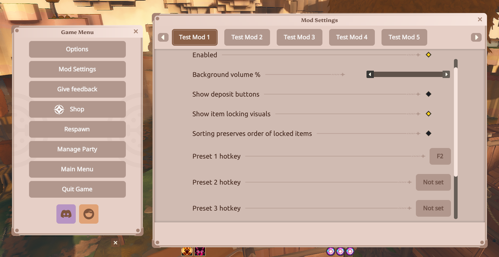

# Better Mod Settings

[Builds](https://github.com/xWink/farever-mods/actions/workflows/build-better-mod-settings.yml) · [Releases](https://github.com/xWink/farever-mods/releases?q=better-mod-settings%2Fv&expanded=true)

Adds a **Mod Settings** button to Farever's Game Menu, with native controls for compatible mods.

## Installation

Requires HLX Core 0.0.8+. Download from [Nexus Mods](https://www.nexusmods.com/farever/mods/10) or Releases, then follow the [installation instructions](../README.md#installation).

## Usage

- Open **Game Menu → Mod Settings** and select a mod's tab.
- Changes save automatically. Compatible mods apply them immediately.
- Click a hotkey control to assign a key or modifier combination; right-click to clear it.
- Use the eye button to show or hide a secret field. Masking hides text on screen; it does not encrypt the saved value.

## For mod authors

See the [integration guide](docs/configuration.md) for configuration descriptors, controls, shared settings, and change notifications.

See [Building](../README.md#building) for source builds and tests.
